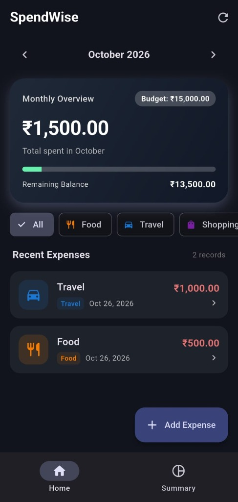
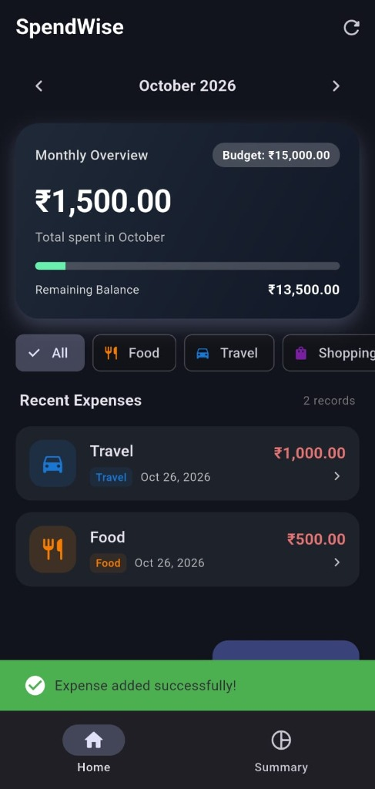
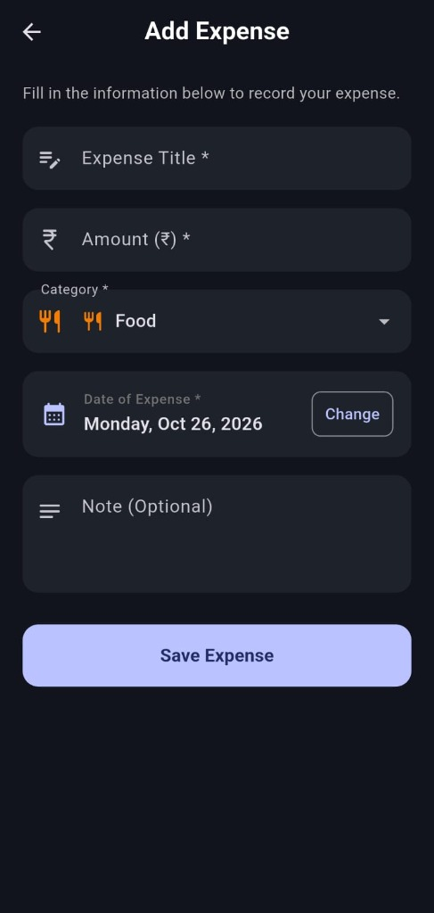
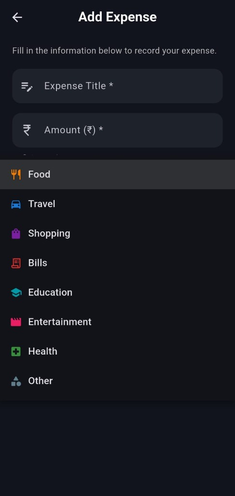
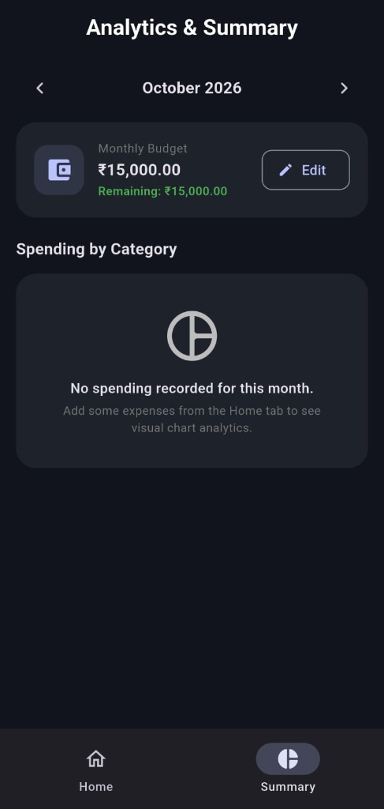

# SpendWise - Expense & Budget Tracker 💰📊

[](https://flutter.dev)
[](https://dart.dev)
[](https://pub.dev/packages/sqflite)
[](LICENSE)
[](https://developer.android.com)

**SpendWise** is a clean, modern, offline personal expense and budget tracking mobile application built using **Flutter** and **SQLite** (`sqflite`). Designed specifically as an academic mini-project for the **Mobile Application Development (MAD)** curriculum, the codebase emphasizes clean architecture, comprehensive comments, strict input validation, and an intuitive Material 3 UI/UX with smooth dark mode aesthetics.

---

## 📸 App Screenshots

| Dashboard & Overview | Expense Added Feedback | Add Expense Form |
| :---: | :---: | :---: |
|  |  |  |

| Category Selector | Analytics & Budget Summary |
| :---: | :---: |
|  |  |

---

## 📱 Features

- **Full CRUD Operations**: Create, read, update, and delete daily expenses with instant database synchronization.
- **Monthly Budget Tracking**: Set and update monthly budgets with real-time remaining balance calculations.
- **Visual Over-Budget Warning**: Prominent alert banner activates immediately when spending exceeds the monthly allocated limit.
- **Interactive Visual Analytics**: Category-wise expenditure breakdown powered by an interactive **`fl_chart` Pie Chart**.
- **Dynamic Category & Month Filtering**: Filter transactions seamlessly using horizontal category chips or month navigation selectors.
- **Swipe-to-Delete**: Intuitive swipe action with a safety confirmation dialog and instant Undo capability via SnackBar.
- **100% Offline & Private**: Zero external dependencies on Firebase, logins, or cloud APIs. All data remains securely stored in a local SQLite database file on the device.
- **Adaptive Material 3 Design**: Supports sleek dark theming with custom card elevation, rounded corners, and clear iconography.
- **Robust Input Validation**: Strict client-side validation for required titles (minimum 2 characters), positive non-zero numerical amounts, valid categories, and past/present dates.

---

## 🛠️ Tech Stack & Packages

| Component | Technology | Description |
| :--- | :--- | :--- |
| **Framework** | Flutter (v3.47+ Stable) | Cross-platform UI toolkit |
| **Language** | Dart (v3.13+) | Strongly-typed object-oriented programming language |
| **Local Database** | `sqflite` (v2.3.3+) | Embedded SQLite database engine for Flutter |
| **Path Utility** | `path` (v1.9.0) | Cross-platform filesystem path utility |
| **Charts** | `fl_chart` (v0.69.0) | Interactive category distribution pie chart |
| **Formatting** | `intl` (v0.19.0) | Date formatting & Indian Rupee (`₹`) currency presentation |
| **Icons** | `cupertino_icons` & Material Icons | Modern iconography |
| **Testing** | `flutter_test` | Unit and model serialization testing |

---

## 📂 Project Structure

```text
SpendWise/
├── android/                         # Android native project files & Gradle configuration
├── lib/
│   ├── main.dart                    # Application entry point, Material 3 theming & navigation
│   ├── models/
│   │   └── expense.dart             # Expense data model & SQLite Map serialization
│   ├── database/
│   │   └── db_helper.dart           # SQLite singleton, table creation, queries & budget ops
│   ├── screens/
│   │   ├── home_screen.dart         # Home dashboard: budget card, warnings, filters, list
│   │   ├── add_edit_screen.dart     # Form screen for creating/updating expenses with validation
│   │   └── summary_screen.dart      # Analytics: pie chart, budget updater & category totals
│   ├── widgets/
│   │   └── expense_tile.dart        # Reusable dismissible expense card with confirmation
│   └── utils/
│       └── validators.dart          # Form input validation logic for title, amount, budget
├── screenshots/                     # UI screenshots of the application
├── test/
│   └── unit_tests_test.dart         # Unit tests for validators and Expense serialization
├── analysis_options.yaml            # Linter rules and static code analysis
├── pubspec.yaml                     # Dependencies, assets, and project metadata
├── README.md                        # Project documentation and viva preparation guide
└── TEST_CASES.md                    # 10 manual and automated functional test cases
```

---

## 🚀 Setup & Execution Guide

### Prerequisites
1. **Flutter SDK**: [Install Flutter](https://docs.flutter.dev/get-started/install) (ensure `flutter` is added to your system `PATH`).
2. **Java JDK**: OpenJDK 17 or above.
3. **Android Studio / VS Code**: With Flutter & Dart extensions installed.
4. **Android Device or Emulator**: Android 8.0+ (API level 26+).

### Step 1: Clone the Repository
```bash
git clone https://github.com/HeelSoni/SpendWise_MAD.git
cd SpendWise_MAD
```

### Step 2: Install Dependencies
```bash
flutter pub get
```

### Step 3: Run Unit Tests
Verify all validation rules and model serialization:
```bash
flutter test
```

### Step 4: Run the Application
Launch on your connected Android device or emulator:
```bash
flutter run
```

### Step 5: Build Release APK
To compile the standalone production Android package (`.apk`):
```bash
flutter build apk --release
```
The compiled APK will be located at:
```text
build/app/outputs/flutter-apk/app-release.apk
```

---

## 🧪 Testing

Automated test cases covering model serialization and input validation are provided in `test/unit_tests_test.dart`.

To execute tests:
```bash
flutter test
```

For detailed manual testing scenarios (10 functional test cases covering Add, Edit, Delete, Filter, Budget Calculation, and Edge Cases), refer to [TEST_CASES.md](TEST_CASES.md).

---

## 🎓 College Viva & Defense Notes (Q&A)

### Q1: Why use SQLite (`sqflite`) instead of SharedPreferences or Firebase?
- **Answer**: `SharedPreferences` is only designed for primitive key-value pairs (e.g., settings flags), not relational financial records that need aggregation. `Firebase` requires an internet connection, authentication, and external billing/cloud setup. SQLite provides a full ACID-compliant offline SQL relational engine directly on the device, allowing queries like `SUM(amount) GROUP BY category` and `WHERE date LIKE '2026-10%'`.

### Q2: How does the Singleton Pattern work in `DBHelper`?
- **Answer**: `DBHelper._init()` is a private constructor, and `DBHelper.instance` is the single static instance. This guarantees that only one database connection handle is ever opened throughout the entire app lifecycle, preventing lock contention and database corruption.

### Q3: How is date filtering implemented in SQLite?
- **Answer**: Dates are stored in ISO 8601 string format (`YYYY-MM-DDTHH:mm:ss`). In `db_helper.dart`, monthly filtering uses SQL wildcard matching: `WHERE date LIKE '2026-10%'`, which efficiently matches all records belonging to October 2026 without requiring runtime conversions.

### Q4: How is state managed between the Home and Add/Edit screens?
- **Answer**: The application uses clean `StatefulWidget` and `setState` along with asynchronous navigation (`Navigator.push`). When returning from `AddEditScreen`, the route pops with a boolean result `true`, prompting `HomeScreen` to execute `_loadData()` and fetch updated records from SQLite.

### Q5: What happens when the monthly budget is exceeded?
- **Answer**: `_totalSpent` is compared against `_monthlyBudget`. If `_totalSpent > _monthlyBudget` and `_monthlyBudget > 0`, `isBudgetExceeded` evaluates to `true`. This triggers a prominent warning banner with an alert icon and exact overspent calculation, while coloring the progress bar red.

---

## 📄 License

This project is open-source and available under the [MIT License](LICENSE).
